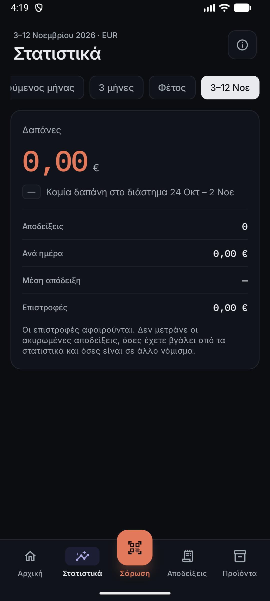
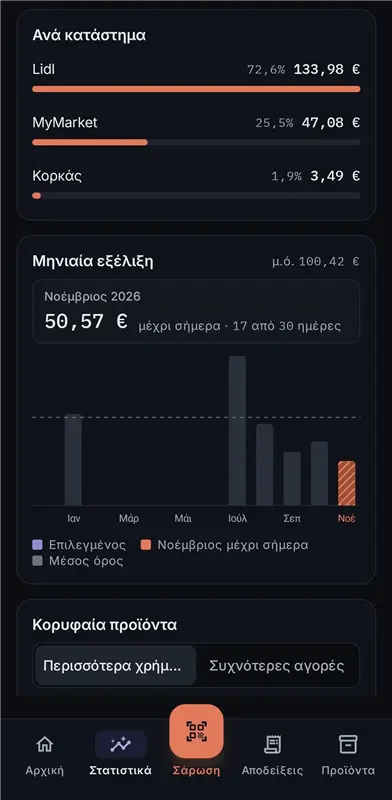
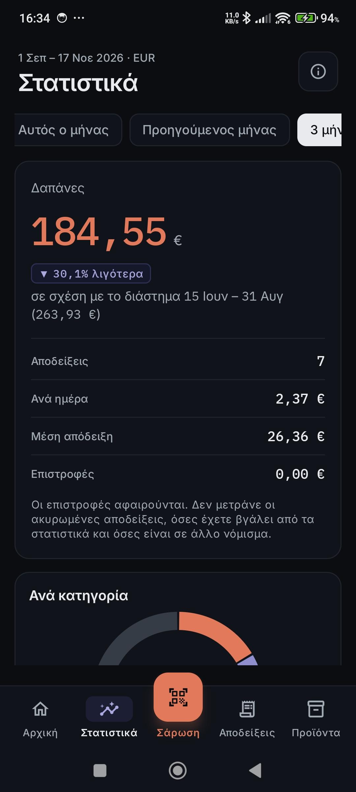

# Eksoda for Android

[](https://github.com/tsaklidis/MyEksoda/actions/workflows/ci.yml)
[](https://github.com/tsaklidis/MyEksoda/releases)

Eksoda is a standalone, privacy-first Android household expense app built around Greek e-receipts. Simply scan the QR code on a receipt, and Eksoda downloads the official e-receipt data directly from the issuing company. It tracks your spending, itemized product costs over time, and price comparisons across merchants.

## 📲 Install

Eksoda is not on Google Play: each version is published as an APK on the
[Releases](https://github.com/tsaklidis/MyEksoda/releases) page. It needs Android 8.0 or newer.

1. On your phone, open the [Releases](https://github.com/tsaklidis/MyEksoda/releases) page and,
   under **Assets** of the newest release, tap `eksoda-<version>.apk` to download it.
2. Open the downloaded file (from the download notification or the Files app).
3. If Android asks, allow your browser or Files app to **install unknown apps**, then go back
   and tap **Install**.
4. Google Play Protect may warn that the app is from an unknown developer, because it does not
   come from Google Play. Tap **More details → Install anyway**.

**Updating:** install the newer APK the same way, over the installed app. Your data is kept.
Do not uninstall first: your receipts exist only on your phone, and uninstalling deletes them.
Export a backup now and then (**Settings → Export data**) to be safe.

**Verifying (optional):** each release lists the APK's SHA-256 checksum and the signing
certificate. Every release is signed with the same key (certificate SHA-256
`D3:72:B3:59:A9:53:5D:8D:70:D0:06:0C:BC:03:6C:02:EB:82:E5:19:B9:17:35:A1:D3:3B:1A:8F:8B:DB:5E:CB`),
which you can check with `apksigner verify --print-certs eksoda-<version>.apk`.

> Tip: [Obtainium](https://github.com/ImranR98/Obtainium) can watch this repository's releases
> and update the app for you.

---

## 🔒 Privacy First

- **Your receipts never leave your phone.** There is no backend server and no user account.
- **Direct-only network access:** The app connects exclusively to registered receipt provider hosts via HTTPS (system CAs only).
- **Encrypted storage:** All data is stored locally in an encrypted Room database (SQLCipher) secured by an Android Keystore wrapping key.
- **Zero telemetry:** No Firebase, no analytics, no crash reporting SDKs, no tracking.
- **Passphrase-protected backups:** Local backup files are encrypted using AES-256-GCM with PBKDF2-HMAC-SHA256 key derivation.
- **Independent Recovery:** Includes [`decrypt_bu.py`](decrypt_bu.py), a Python utility to decrypt and inspect backup files independently of the Android app, ensuring your data is never locked in.

---

## 📱 Features

- **QR Code Scanning:** Instant receipt import by scanning the receipt's QR code using high-performance zxing-cpp decoding.
- **Smart Parsing & Classification:** Automatic line classification, normalization, package size detection, and category matching.
- **Spending Insights:** Period-based analytics (weekly, monthly, custom ranges) with interactive charts.
- **Product & Price History:** Track price evolution and find the cheapest merchants for any product.

---

## 🛠️ Technology Stack

- **Language:** Kotlin 2.4.21
- **UI:** Jetpack Compose & Material 3
- **Architecture:** Clean Architecture (`core:engine`, `core:database`, `core:data`, `core:model`, `core:ui`, feature modules)
- **Database:** Room with SQLCipher encryption
- **Dependency Injection:** Hilt
- **Background Processing:** WorkManager (for robust import scheduling & retries)
- **Networking:** OkHttp (`SafeFetcher` with host allowlist and public DNS)
- **Scanning:** zxing-cpp

---

## 📱 Compatible Android Versions

- **Minimum SDK:** API 26 (Android 8.0 Oreo)
- **Target SDK:** API 36 / Compile SDK 37

---

## 📸 Screenshots

<table>
  <tr>
    <td align="center"><br><sub>Home</sub></td>
    <td align="center"><br><sub>Stats</sub></td>
    <td align="center"><br><sub>Stats detail</sub></td>
    <td align="center"><br><sub>Insights</sub></td>
  </tr>
</table>

---

## 🏗️ Building & Testing

The project uses Gradle with convention plugins and a Makefile for quality checks:

```bash
make check           # Runs lint, ktlint, typed detekt, tests, Kover coverage, and no-telemetry checks
make test            # Runs unit tests
make build           # Builds debug APK
make codemap         # Regenerates documentation symbols map
make install_rc      # Install with adb
make new_release     # Check, bump the version and build the signed eksoda-<version>.apk
make release_key     # Once per machine: create the release signing key in ~/.eksoda
```

## 📦 Backup Recovery (`decrypt_bu.py`)

If you have an Eksoda backup file (`.eksoda`) and cannot access the Android app, you can decrypt and inspect your backup data independently using the Python recovery script:

```bash
pip install cryptography
python3 decrypt_bu.py your_backup.eksoda [output_archive.zip]
```

## Documentation

| Document | Description |
|---|---|
| [`docs/codemap/OVERVIEW.md`](docs/codemap/OVERVIEW.md) | Architecture, modules, import pipeline, data layer, backup, and rules |
| [`docs/design/ui-redesign.md`](docs/design/ui-redesign.md) | UI rules: color meanings, type, components, charts |

## License

MIT, see [LICENSE](LICENSE).
